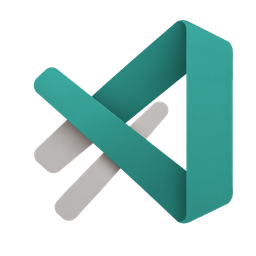
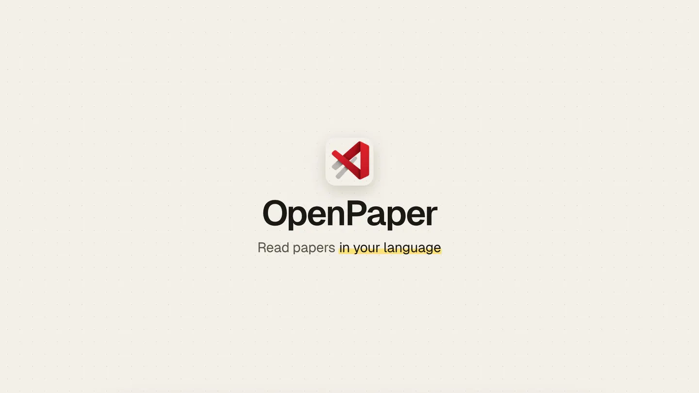

<div align="center">



# OpenPaper

**[sionic-ai.github.io/openpaper](https://sionic-ai.github.io/openpaper/)**

Read an English research paper side by side with its translation, sentence by sentence.

[](https://github.com/sionic-ai/openpaper/releases/latest)
[](https://github.com/sionic-ai/openpaper/actions/workflows/ci.yml)
[](LICENSE)
[](#install)
[](https://tauri.app)

</div>

<a href=".github/assets/demo.mp4"></a>

## Install

### macOS

```sh
curl -fsSL https://raw.githubusercontent.com/sionic-ai/openpaper/main/install.sh | bash
```

Run it again to update. The app also shows an Update button when a new release is out.

The installer puts `OpenPaper.app` in `/Applications` (or `~/Applications`), installs [Claude Code](https://docs.claude.com/claude-code) if it is missing, and starts the Claude Code login if you are not logged in. Translation uses your Claude Code account by default, so there is no API key to set. You can switch to Codex or an API key in the app (see [Models](#models)). Requires macOS 11 or later.

<details>
<summary>Installer options</summary>

Options go after `bash -s --`, for example `... | bash -s -- --no-open`:

| Option | Env var | What it does |
|---|---|---|
| `--no-claude` | `OPENPAPER_NO_CLAUDE=1` | Skip installing and logging in to Claude Code |
| `--no-login` | `OPENPAPER_NO_LOGIN=1` | Never start the Claude Code login |
| `--no-open` | `OPENPAPER_NO_OPEN=1` | Do not open the app at the end |
| `--dir <path>` | `OPENPAPER_DIR` | Install into this folder |
| `--version <tag>` | `OPENPAPER_VERSION` | Install a specific release tag |
| `--check` | | Print what is installed and change nothing |
| `--uninstall` | | Remove the app, keep your papers |
| `--purge` | | With `--uninstall`, also delete your papers |

Exit codes: `0` ready, `1` error, `2` app installed but Claude Code is not logged in. Agents installing for a user should follow [AGENTS.md](AGENTS.md).

</details>

### Windows

Download [OpenPaper-windows-x64-setup.exe](https://github.com/sionic-ai/openpaper/releases/latest/download/OpenPaper-windows-x64-setup.exe) and run it. It installs for your user only, with no admin rights, and adds OpenPaper to the Start menu. The app shows an Update button when a new release is out.

The setup program is not code-signed, so Windows SmartScreen may warn about it. Choose **More info**, then **Run anyway**.

By default, translation uses [Claude Code](https://docs.claude.com/claude-code) (or pick Codex or an API key under [Models](#models)). If Claude Code is not installed, run this in PowerShell, then log in:

```powershell
irm https://claude.ai/install.ps1 | iex
claude auth login
```

Requires Windows 10 or 11 (x64) and a Claude account. The setup program installs Microsoft Edge WebView2 if it is missing.

## What you get

- **Side by side reading.** The original on one side, the translation on the other, paired sentence by sentence. Hover or select a sentence and its pair lights up on both sides. Swap sides with `⇄` and drag the divider to resize, or show only the original or only the translation. Press `⌘F` to find text in both columns, and `⌘+` / `⌘−` to make the paper's text bigger or smaller (70–150 %, `⌘0` resets). Reopening a paper returns to where you stopped reading.
- **Pick your language.** Translate into Korean, Japanese, Chinese (Simplified), Spanish, French, German, or Portuguese.
- **arXiv search.** Search arXiv inside the app, or paste an arXiv ID or URL. Links from other paper sites (ACL Anthology, PMLR, NeurIPS, CVF, JMLR, Hugging Face Papers, a journal page) and DOIs paste into the same box: the arXiv version opens when there is one, otherwise the site's PDF. Local PDFs work too.
- **AI paper finder.** Describe what you are looking for in plain words. Claude plans the searches, and the app only shows papers that came back from arXiv, never invented ones. Press Translate on several results in a row: each one fetches and translates in its own tab behind the list.
- **Easy mode.** Switch to Easy and it starts at once: an explanatory translation that unpacks jargon and adds the missing reasoning, while keeping facts and numbers as written.
- **Summary post.** One click writes a short explainer post about the paper with its real numbers. It is saved and shows up instantly next time.
- **Ask the paper.** Ask questions in a chat grounded in the open paper. Select any passage to ask about it directly. Answers stream in as they are written.
- **Tabs.** Press `⌘T` (`Ctrl+T` on Windows) for a new tab and keep several papers and searches open at once. `⌘W` closes a tab, `⌃Tab` and `⌘1`–`⌘9` switch tabs, and `⌘`-click opens a paper in a new tab.
- **Folders and dark mode.** Drag papers onto each other to group them. Light and dark themes follow the system until you pick one.
- **In-app update.** An Update button appears when a new release is out.

## Models

Translation, summaries, questions, and the AI finder use one model backend, picked under **Model** at the bottom of the sidebar:

| Backend | What you need | Notes |
|---|---|---|
| Claude Code (default) | A logged-in `claude` CLI | No key. Uses your Claude plan |
| Codex | A logged-in `codex` CLI (or the ChatGPT app, which includes it) | No key. Uses your ChatGPT plan. Answers arrive whole, not streamed |
| Anthropic API | An Anthropic API key | Default model `claude-sonnet-5-5` |
| [OpenGateway](https://opengateway.ai) | An OpenGateway API key | One key for Claude, GPT, Gemini, DeepSeek and more. Default model `anthropic/claude-sonnet-5-5` |
| OpenAI-compatible | An API key and a model | Presets for OpenAI, OpenRouter, DeepSeek, Google Gemini, and a local Ollama (no key), or any custom `https://` address. The model list shows what the endpoint offers |

**Roadmap**: the Roadmap button next to Summarize lays out what to read before and after the open paper, in stages. Every paper in it is real: candidates come from the paper's own references and from [OpenAlex](https://openalex.org) (papers it cites and papers that cite it, most cited first), each is checked on arXiv, and the model only orders and explains them. In AI search you can also ask "make a roadmap for this paper", or name a topic ("I want to research LLM memory, give me a roadmap"): it picks a starting paper on arXiv and builds the roadmap from it. The roadmap is saved with the paper.

**Read check**: hover a paper in the sidebar and click the check to mark it read; click again to clear it.

The interface follows the language you translate into (Korean, Japanese, Chinese, Spanish, French, German or Portuguese).

**Backups**: pick one or more other backends under Backups. When the chosen one hits a usage limit, runs out of credit, or isn't logged in, the next backup answers instead, and the sidebar shows which model is answering. The chosen backend is tried again within 20 minutes. A reply that already started streaming never switches midway.

Keys are saved in `keys.json` next to your papers (readable only by you on macOS), never shown again in the app, and only sent over https or to your own computer. **Test** makes one tiny call to check the setup. API calls are billed to your API account; a long paper takes dozens of calls.

## How it works

- **Your model, isolated.** By default every model call runs `claude -p` with tools, MCP servers, and settings turned off, in an empty temporary folder. Codex runs the same way in a read-only sandbox. The app sends paper text and reads JSON or text back.
- **No invented papers.** The AI finder lets Claude plan queries, fetches real results from the arXiv API, and keeps only picks whose IDs are in those results.
- **Your files stay local.** Papers, translations, summaries, and folders are plain JSON files in `~/Library/Application Support/dev.rlaope.openpaper/papers/` on macOS and `%APPDATA%\dev.rlaope.openpaper\papers\` on Windows.

The full pipeline, file formats, and the command-line probe are in [docs/ARCHITECTURE.md](docs/ARCHITECTURE.md).

## Build from source

Needs Rust 1.85+, Node 20+, pnpm, and a logged-in `claude` CLI (`claude auth status`).

```sh
pnpm install
pnpm dev          # run the app in development
pnpm build        # typecheck and build the web side
pnpm tauri build  # macOS: src-tauri/target/release/bundle/macos/OpenPaper.app
                  # Windows: pnpm tauri build --bundles nsis → bundle/nsis/OpenPaper_<version>_x64-setup.exe
```

## Uninstall

```sh
curl -fsSL https://raw.githubusercontent.com/sionic-ai/openpaper/main/install.sh | bash -s -- --uninstall
```

Add `--purge` to also delete your papers. By hand: `rm -rf /Applications/OpenPaper.app`, and `~/Library/Application Support/dev.rlaope.openpaper` for the papers.

On Windows, remove OpenPaper in **Settings > Apps > Installed apps**. Your papers stay in `%APPDATA%\dev.rlaope.openpaper`; delete that folder to remove them too.

## Limits

- macOS 11+ and Windows 10/11 (x64). Linux is not supported.
- On Windows, only Claude Code from the official installer (`claude.exe`) is found. An npm install (`claude.cmd`) is not used.
- The macOS build is ad-hoc signed, not notarized, and the Windows setup program is not code-signed. The installer clears the download quarantine. If you download the zip in a browser, right-click the app and choose Open the first time.
- PDFs use the text layer only. Scanned PDFs do not work, and PDF equations, figures, and tables show as plain text.
- Speed and quality follow your Claude Code account's model and usage limits.

## Sponsor

<a href="https://opengateway.ai"></a>

OpenPaper is sponsored by [OpenGateway](https://opengateway.ai): one API key for Claude, GPT, Gemini, DeepSeek and more. Pick it under **Model** in the app and it works as soon as the key is saved.

## Contributing

Issues and pull requests are welcome. See [CONTRIBUTING.md](CONTRIBUTING.md). Report security issues privately as described in [SECURITY.md](SECURITY.md).

## License

[MIT](LICENSE)
